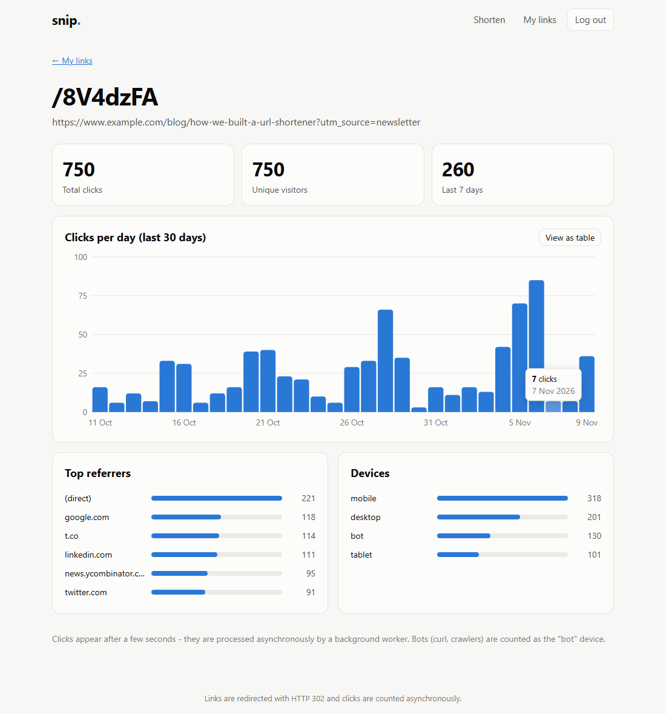
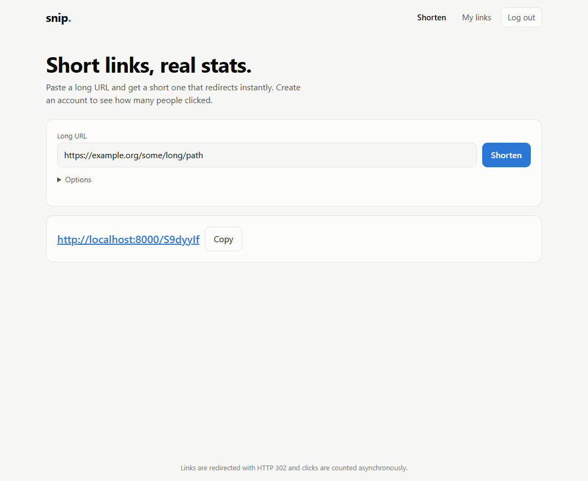
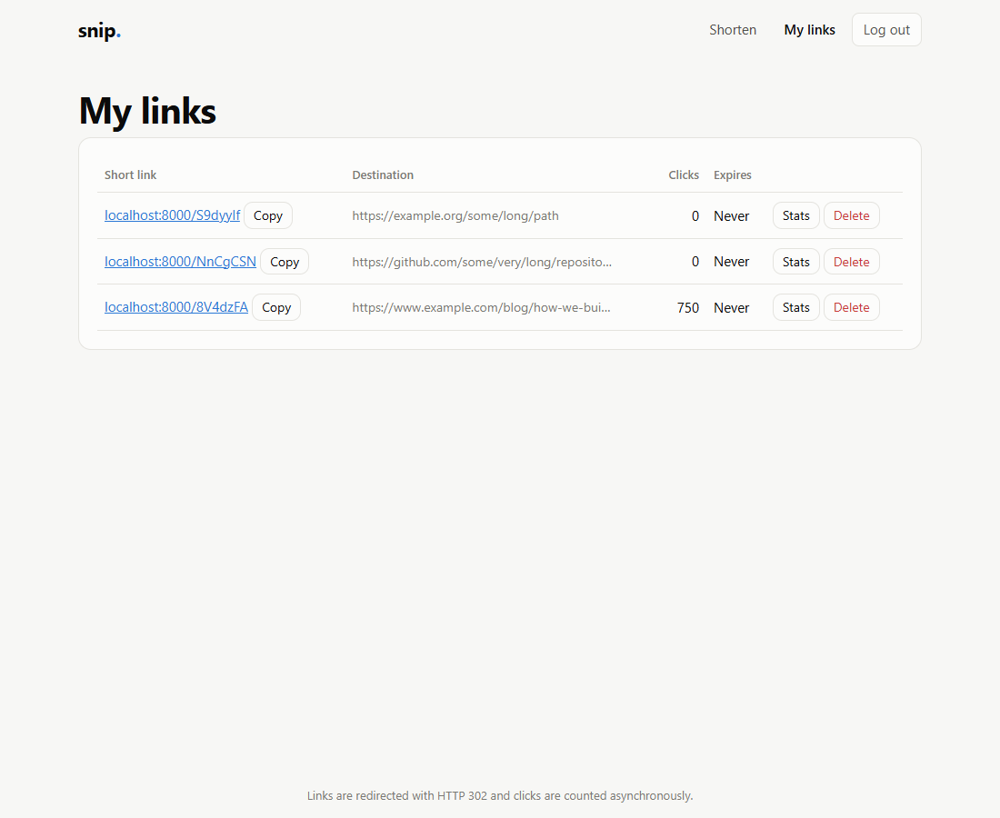
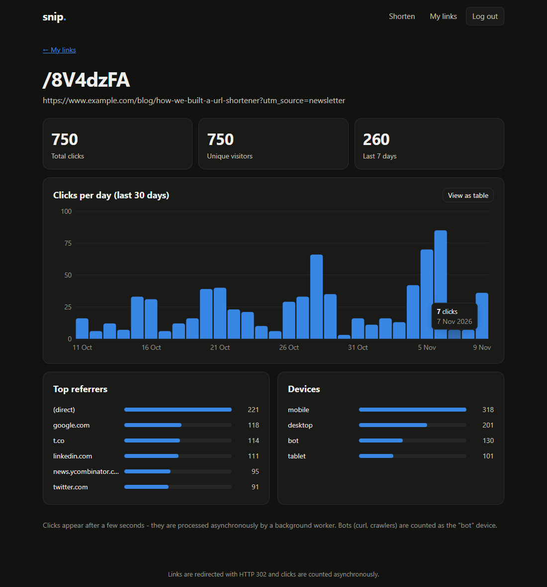
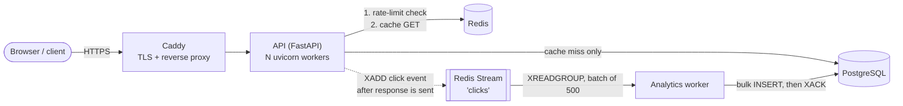

# snip. — a URL shortener built for load and failure

A bit.ly-style service: shorten a link, redirect people to the original, and show the owner how many people clicked. Built to be **fast under load** and to **degrade gracefully when its dependencies die**, with measurements to prove it.

**Stack:** Python 3.12 · FastAPI · PostgreSQL 16 · Redis 7 (cache, rate limiting, event queue) · Docker Compose · k6 · Caddy (HTTPS)

**Run it in one command:** `docker compose up -d --build` → http://localhost:8000 (see [Run it locally](#run-it-locally)). Production files (Caddy + auto-HTTPS) are included: see [Deploy](#deploy).

<p align="center">
  
</p>

<details>
<summary>More screenshots (home, dashboard, dark mode)</summary>

| Shorten | My links |
|---|---|
|  |  |


</details>

| What | How |
|---|---|
| Redirects | Redis cache-aside in front of Postgres, ~2 ms p95 at 1,000 req/s on a laptop |
| Rate limiting | Atomic token bucket in a Redis Lua script, per-IP and per-user |
| Analytics | Click events go through a Redis Stream to a worker; the redirect never waits for a database write |
| Auth | argon2 password hashes, short-lived JWTs, per-user link management |
| Resilience | Circuit breakers, fail-open limiter, single-flight cache misses — all verified by killing Redis and Postgres under load |
| Tests | 46 automated tests (unit + integration against real Postgres and Redis) |

---

## Architecture



**A redirect, step by step**

1. `GET /k3Fz9Qa` → token-bucket check in Redis (`429` if the client is over its limit).
2. Redis `GET link:k3Fz9Qa`. **Hit** → done. **Miss** → one Postgres query (concurrent misses for the same code share it), then the result is cached.
3. Respond `302 Location: <original url>`.
4. *After* the response is sent, drop a click event onto the Redis Stream. A separate worker writes events to Postgres in batches.

Redis is an optimisation, never a dependency: if it is down, redirects still work straight from Postgres.

---

## ID generation: why a scrambled counter

The short code must be **unique** and shouldn't be **guessable**. I compared three options:

| Approach | Collisions | Enumerable? | Verdict |
|---|---|---|---|
| Hash of the URL (MD5/SHA, truncated) | **Yes** — needs check-and-retry; same URL always gets the same code, breaking per-user links and stats | No | ✗ |
| Plain base62 counter (1→`1`, 2→`2`…) | None | **Yes** — anyone can walk every link in the system | ✗ |
| **Counter → keyed Feistel permutation → base62** | **None, by construction** | No (looks random) | ✅ **chosen** |

How it works ([`app/idgen.py`](app/idgen.py)):

1. `nextval()` on a Postgres sequence gives a unique number. It is atomic, so many API processes can insert at once without coordination.
2. A 4-round **Feistel network** (HMAC-SHA256 round function, secret key) scrambles the number. A Feistel network is a bijection, so two different inputs can never produce the same output. No collision check, no retry, no extra DB round trip.
3. The permutation works on 42 bits (4.4·10¹²) but codes must fit 62⁷ (3.5·10¹²), so **cycle-walking** re-applies it until the result lands in range (~1.25 iterations on average). It is still a bijection.
4. Base62-encode to exactly 7 characters → ~3.5 trillion possible codes.

*Honest caveat:* this is obfuscation, not cryptography. It defeats casual enumeration; it isn't meant to stop a determined cryptanalyst. Custom aliases share the same unique-indexed `code` column, so alias races are resolved by the database (`409`).

---

## Benchmarks: before and after the cache

Redirect load (k6, constant arrival rate, 30 s, 500 links, random pick), `CACHE_ENABLED=false` vs `true`. Rate limiting off in both so only the cache differs. Click analytics is on in both.

| Offered load | | Cache **OFF** | Cache **ON** |
|---|---|---|---|
| **1,000 req/s** | p50 / p95 / p99 | 1.72 / 4.02 / 23.2 ms | **1.04 / 2.61 / 17.9 ms** |
| **2,000 req/s** | p50 / p95 / p99 | 9.1 / 46.5 / 94.6 ms | **2.28 / 14.3 / 36.2 ms** |
| **3,500 req/s** (overload) | achieved throughput | 1,816 req/s | **2,571 req/s** |
| | p50 / p95 | 958 ms / 3.0 s | **174 / 326 ms** |
| | failed requests | 6.35 % | **0.26 %** |

**Reading the numbers honestly**

- At 1,000 req/s both are fast: Postgres on the same machine with a warm index is very quick. The cache's win is clearest as load rises: at 2,000 req/s p95 drops **3×** (46→14 ms) and at overload the cache variant serves **~40 % more throughput** with **24× fewer failures**.
- Throughput saturates around ~1,900 (no cache) vs ~2,600 req/s (cache) on this machine. With the cache on, the bottleneck becomes Python (2 uvicorn workers), not the database.
- The p99 of 20 s in the cached overload run is queueing after saturation, not a cache effect.
- **Hardware caveat:** everything — k6, API, worker, Postgres, Redis — ran on one laptop (Intel i5-1335U, Docker limited to 4 CPUs / 4 GB via WSL2), so the load generator competes with the system under test. Absolute numbers will be higher on separate machines; the *relative* result is what matters. Raw k6 summaries are in [`loadtest/results/`](loadtest/results/).

Reproduce:

```bash
RATE_LIMIT_ENABLED=false CACHE_ENABLED=false docker compose up -d api
docker compose --profile load run --no-deps --rm k6 run -e RATE=2000 -e DURATION=30s \
    --summary-export /scripts/results/cache-off-2000.json /scripts/redirect.js
# then again with CACHE_ENABLED=true
```
(`--no-deps` matters: without it `docker compose run` recreates the API with default env vars.)

---

## Rate limiting

A **token bucket** per client: it holds up to `burst` tokens, each request spends one, and tokens refill at `rate`/second. That allows short bursts but caps the sustained rate, and it has no "double traffic at the window boundary" flaw of fixed windows.

- State lives in Redis, so every API process shares one view of each client.
- It runs as a **Lua script**, which Redis executes atomically. A Python read-modify-write would let two workers both see "1 token left". A test fires 50 concurrent requests at a 10-token bucket and asserts exactly 10 pass. The script uses Redis' own clock (`TIME`), so API servers can't disagree about time.
- Keys: logged-in users are limited **per user**, anonymous traffic **per IP**; redirects, link creation and login/register each have their own bucket (login is strict to slow password guessing).
- Responses are `429` with a `Retry-After` header.
- **Fails open:** if Redis is unreachable, requests are allowed. Being briefly unprotected beats a redirect service being fully down.

Measured against the running stack (burst 100, 50/s): 300 rapid redirects from one IP → first 120 served, remaining 179 got `429`; after 3 s the bucket had refilled. Anonymous link creation: 5 succeed, then `429`.

---

## Async analytics

The redirect must stay fast, so it never touches the clicks table. After the response is sent it appends a small event to a **Redis Stream**; the worker ([`app/worker.py`](app/worker.py)) consumes it in a **consumer group**, writes up to 500 events per SQL statement, and only then `XACK`s.

- **At-least-once delivery.** If the worker crashes or Postgres is down, events stay *pending* and are re-delivered (`XAUTOCLAIM`) after 5 s. Worst case a click is stored twice; that is acceptable for counters.
- Poison events (malformed) and clicks for deleted links are dropped rather than blocking the queue forever.
- The stream is capped (`MAXLEN ~ 100k`) so a dead worker can't fill Redis memory, and Redis runs with AOF persistence so queued clicks survive a Redis restart.
- Raw IPs are never stored; a keyed hash is, which still allows counting unique visitors.
- Stats: totals, unique visitors, clicks per day (zero-filled), top referrers, devices.

---

## Auth

- Passwords: **argon2** (deliberately slow; run in a thread so it doesn't block the event loop). Login returns the same error for a wrong password and an unknown email, so emails can't be enumerated.
- **JWT** access tokens (HS256, 60 min). The server verifies the signature, with no session lookup. Trade-off: tokens can't be revoked before expiry, hence the short lifetime.
- Ownership is enforced in SQL (`WHERE code = $1 AND user_id = $2`); someone else's link looks identical to a non-existent one (`404`), so ids can't be probed.
- Anonymous users can create links (stricter rate limit) but get no stats.

---

## Failure scenarios (load test + chaos)

[`loadtest/chaos.sh`](loadtest/chaos.sh) runs steady traffic (**800 req/s**; 80 % popular cached links, 20 % from a 20,000-link long tail that mostly misses the cache) while it:

| t | Event |
|---|---|
| 15 s | `docker compose stop redis` |
| 30 s | `docker compose start redis` |
| 40 s | `docker compose stop db` (Postgres) |
| 55 s | `docker compose start db` |

I ran it twice: once on the first implementation, then again after fixing what it exposed.

### Run 1 — what broke

| Phase | Symptom | Root cause |
|---|---|---|
| **Redis down** | Every redirect still succeeded, but p50 went **1.2 ms → ~500 ms** | Each request waited on two Redis timeouts (cache `GET` + `SET`, 0.25 s each); the click `XADD` in the background task also held keep-alive connections |
| **Redis back** | Latency stayed ~430 ms for 10+ s | Requests kept trying the dead connections; no way to "notice" recovery quickly |
| **Postgres down** | ~17 % of requests failed (the cache misses), each after a **3,000 ms hang** | Waiting the full pool-acquire timeout per request; hung requests pile up and exhaust clients |

### Fixes

1. **Circuit breaker** ([`app/breaker.py`](app/breaker.py)) around every Redis call and every DB connection. After 3 consecutive failures it *opens*: calls fail instantly for 2 s, then a single *probe* request is let through (half-open); success closes it.
2. **Shorter DB acquire timeout** (1 s) separate from the query timeout (3 s), plus a TCP connect timeout.
3. **Single-flight cache misses:** 100 concurrent requests for the same uncached code now cost **one** Postgres query (tested), which protects the database from a stampede when a hot key expires or Redis comes back empty.
4. **Graceful 503:** database failures return `503` + `Retry-After` instead of a stack trace or a hang.
5. **Worker bug found along the way:** the worker's blocking `XREADGROUP` (2 s) was being cut off by the API's 0.25 s Redis socket timeout, so it logged a timeout every idle second. The worker now uses its own longer socket timeout.

### Run 2 — after the fixes (same experiment)

| Phase | p50 | p95 | success |
|---|---|---|---|
| Baseline (t=5–15, after warm-up) | 1.1–1.2 ms | 3 ms | 100 % |
| **Redis down** (t=15–30) | **1.0–1.2 ms** (was ~500 ms) | **2–4 ms** | **100 %** |
| Redis back (t=30–40) | 1.2 ms | 3 ms | 100 % |
| **Postgres down** (t=40–55) | 0.8–1.2 ms | **1.5–5.8 ms** (was 3,000 ms) | 83–91 % |
| Postgres back (t=55–60) | 1.2 ms | ~4 ms | 100 % |

During the Redis outage users notice **nothing**. During the Postgres outage cached links keep redirecting; only cache *misses* (~17 % in this traffic mix) fail, and they fail in ~2 ms with a `503` rather than hanging for 3 s. Full-resolution tables: `python loadtest/analyze_chaos.py chaos-v1` / `chaos-v2`.

### What data was affected

- **Clicks during a Redis outage are lost** (~4.5k of 57.8k redirects, 7.7 %, in the run). This is a deliberate trade-off: analytics must never slow or break a redirect. Stronger durability would mean a local on-disk spool or writing straight to Postgres on failure, at the cost of complexity and latency.
- **Clicks during a Postgres outage are not lost:** events stay in the stream, un-acknowledged, and are stored after recovery (verified: consumer-group lag and pending both returned to 0).
- **Rate limiting fails open** during a Redis outage (a conscious availability-over-protection choice).

### Known limits

- A cached link that is **deleted** is removed from Redis immediately, but a request that read the old value just before the delete can re-cache it for up to the TTL (1 h). Fine for this product; a stricter design would use versioned keys.
- Click counts per link are computed with `count(*)` on demand. At large scale you would pre-aggregate (per-day rollup table) instead.
- Single Postgres and single Redis: no replication or failover.

---

## Run it locally

Requirements: Docker Desktop (WSL2 on Windows).

```bash
cp .env.example .env              # then set the secrets
docker compose up -d --build      # db, redis, api, worker
open http://localhost:8000        # UI;  API docs at /docs
```

First start creates the schema from [`migrations/`](migrations/). If you change the schema, recreate the database volume: `docker compose down -v`.

| Command | Purpose |
|---|---|
| `docker compose ps` / `logs -f api` | status / logs |
| `docker compose down` / `down -v` | stop / stop **and delete data** |
| `python -m venv .venv && .venv/Scripts/pip install -r requirements.txt` | local Python env for tests |
| `docker compose up -d db redis && pytest` | run the 46 tests (they need Postgres + Redis) |
| `bash loadtest/chaos.sh my-run` then `python loadtest/analyze_chaos.py my-run` | chaos experiment |

## API

| Method | Path | Auth | Description |
|---|---|---|---|
| `POST` | `/api/links` | optional | `{url, alias?, expires_at?}` → `201` short link (`409` alias taken) |
| `GET` | `/{code}` | – | `302` to the original; `404` unknown; `410` expired; `429` rate-limited |
| `GET` | `/api/links` | required | my links with click counts |
| `DELETE` | `/api/links/{code}` | required | delete my link |
| `GET` | `/api/links/{code}/stats` | required | totals, unique visitors, per-day series, referrers, devices |
| `POST` | `/api/auth/register` · `/login` | – | returns a JWT |
| `GET` | `/health` · `/ready` | – | liveness · readiness (Postgres required, Redis optional) |

`302` rather than `301` on purpose: browsers cache a `301` forever, so repeat clicks would never reach the server and could not be counted.

## Deploy

[`docker-compose.prod.yml`](docker-compose.prod.yml) runs the same stack behind **Caddy**, which obtains and renews an HTTPS certificate automatically. Only ports 80/443 are public; Postgres, Redis and the API stay on a private Docker network.

On any Linux VM (a small 1–2 vCPU instance is plenty):

```bash
git clone https://github.com/<your-username>/<repo-name>.git && cd <repo-name>
cp .env.prod.example .env.prod     # set DOMAIN + generate secrets: openssl rand -hex 32
bash deploy/deploy.sh              # installs Docker if missing, builds, starts, waits for /ready
```

No domain? Use `<vm-ip-with-dashes>.sslip.io` (e.g. `203-0-113-7.sslip.io`) as `DOMAIN` — free wildcard DNS, and Caddy can still issue a certificate. Open ports 80 and 443 in the cloud firewall.

Then run the smoke test against the live URL:
```bash
docker compose --profile load run --no-deps --rm k6 run -e BASE=https://YOUR-DOMAIN -e RATE=50 -e DURATION=20s /scripts/redirect.js
```
(Raise `RL_*` limits or expect `429`s from your own load generator: the rate limiter works.)

## Project layout

```
app/
  main.py            app wiring, 503 handlers, /health, /ready, serves the UI
  routes/links.py    create, redirect, list, delete, stats
  routes/auth.py     register / login
  idgen.py           Feistel + base62 code generator
  cache.py           Redis cache-aside, negative caching, single-flight
  ratelimit.py       Lua token bucket + FastAPI dependencies
  breaker.py         circuit breaker
  analytics.py       click producer (Redis Stream)      worker.py   consumer → Postgres
  auth.py            argon2 + JWT                       db.py / redis_client.py   guarded clients
  static/            vanilla-JS single page UI (dashboard, stats chart)
migrations/          SQL schema (applied on first DB start)
loadtest/            k6 scripts, chaos.sh, analyzer, raw results
deploy/              Caddyfile, deploy.sh
tests/               46 tests
```

## Design decisions in one place

- **Postgres sequence → Feistel → base62** for IDs (no collisions, not enumerable).
- **Cache-aside + negative caching + single-flight** for the hot path; TTL capped at link expiry.
- **Redis Streams over RabbitMQ:** consumer groups, acks and retries are built in, and it reuses the Redis already running. One fewer service to operate.
- **Circuit breakers + fail-open** so a dependency outage degrades features instead of taking the service down.
- **Caddy over nginx + certbot** for zero-config HTTPS.
- **No frontend framework:** every user-supplied value is inserted with `textContent`, never `innerHTML`, so a malicious URL can't run script on the dashboard. The JWT lives in `localStorage` (simple; vulnerable to XSS, which the point above mitigates — `HttpOnly` cookies + CSRF protection would be the next step).
